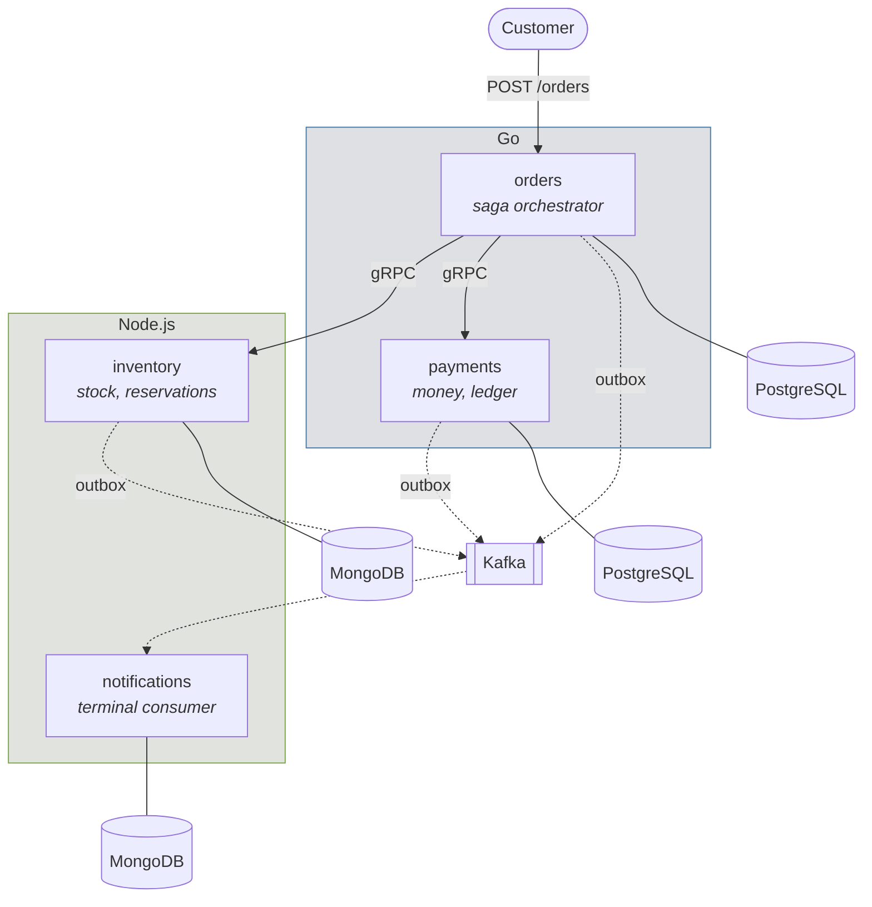

# sw-event-driven-microservices

An event-driven order fulfilment backend in Go and Node.js, built around the parts that are
actually hard: **distributed transactions that can be undone, work that is safe to repeat,
and outcomes that are genuinely unknown.**



**Solid arrows are synchronous commands. Dotted arrows are asynchronous facts.** Every
service owns its own database and nothing reads another's. Nothing publishes to Kafka
directly — everything goes through a transactional outbox.

---

## Run it

```bash
make demo
```

That builds everything, waits for it, and drives four scenarios through the real API: a
successful order, a card declined *after* stock was reserved, an order refused for want of
stock, and a flaky payment provider that fails twice and then succeeds. It prints what each
service reports back rather than asserting success itself.

Then open **<http://localhost:16686>** and search `sw_edm.order_id=<the id it printed>` to
see one trace covering all four services.

<details>
<summary>Other commands</summary>

```bash
make up               # just start everything
make test             # event contract tests + Go unit tests
make test-integration # 15 tests against a running stack
make chaos            # failure injection (DESTRUCTIVE — stops containers, cuts networks)
make down             # stop and remove volumes
```

Requires Docker, Go 1.26+, Node 20+, `curl` and `jq`. Run `make check-tools` first — it
names exactly what is missing rather than failing halfway through a build.

</details>

### On Kubernetes

```bash
make kind-up      # create a 3-node kind cluster, build, load, deploy, wait
make kind-down
```

Same images, no registry. The NodePorts match the compose host ports, so **the integration
suite runs against the cluster unchanged** — which is how it was verified:

```
$ go test -tags=integration ./tests/integration/... -count=1
ok      .../tests/integration   14.658s
```

Twelve pods, one command, and tracing works there too.

---

## What it does

An order needs three things to happen: stock claimed, money taken, stock deducted. They live
in three services with three databases, so **they cannot happen in one transaction.**
Everything here follows from that.

```
1. reserve_stock       inventory   ← compensate: release_stock
2. authorize_payment   payments    ← compensate: void_authorization
3. capture_payment     payments    ← compensate: refund_payment
4. commit_reservation  inventory   ← no compensation, and it is last for that reason
```

Stock is reserved **before** the card is touched, because reserving is free and invisible
while an authorization appears on a customer's statement. Compensation releases stock
**last**, so that a compensation which gets stuck leaves the system holding stock it does
not need rather than having released the stock while still holding the customer's money.

Full reasoning: [`docs/sagas.md`](docs/sagas.md).

---

## The three hard parts

### A timeout is not an outcome

If `AuthorizePayment` times out, orders does not know whether the payment happened. Both
guesses are wrong some of the time — assume failure and you leak a hold on someone's card;
assume success and you confirm an unpaid order.

So the saga records **`UNKNOWN`**, never `FAILED`, and resolves it by *asking*:
`GetPaymentByIdempotencyKey` with the same key it sent. `found=false` is a real answer — it
means the request never arrived and is safe to send again. If it cannot even ask, the step
stays `UNKNOWN` and is retried. **It is never forced to a conclusion.**

### At-least-once delivery, exactly-once processing

Every service writes events to an `outbox` table **in the same transaction as the state
change**, and a relay publishes from there. There is no window in which the state changed
and nobody was told.

The relay can crash after publishing and before marking the row sent, so events may be
published twice. That is accepted rather than fought: it turns an unsolvable distributed
problem into a solvable local one. Every consumer deduplicates on `event_id`.

The system does **not** claim exactly-once delivery, and nothing here says otherwise.

### Compensation is not rollback

A refunded payment is not an un-happened payment — it leaves a trace on the customer's
statement and two entries in the ledger, forever. The domain is built on that: reservations
and authorizations exist precisely because both have a reversible first phase.

---

## Does it actually work?

`make chaos` stops containers, severs docker networks and republishes real messages. Every
figure below is read from `tests/chaos/results/chaos-results.json`, which that command
generates — no number in this README was typed by hand.

| Injected failure | Property proven | Measured |
|---|---|---|
| **Kafka stopped entirely** | Orders are still placed **and fulfilled** | 0 events lost, backlog drained in **4.02s** after recovery |
| **payments stopped, 30s** | The saga holds instead of compensating | **0** orders wrongly cancelled, **0** stock wrongly released |
| **Event republished ×3** | One notification per event per channel | **1** notification, same id |
| **payments partitioned, 40s** | A hung call is never mistaken for a decline | **0** wrongly cancelled, **0** duplicate payments |

The first row is the one worth reading twice. **A total broker outage delays the customer's
email and nothing else** — because the saga runs over gRPC and the events wait safely in the
outbox. That is what the outbox is for, and it is demonstrated rather than claimed.

The last row is why the ambiguous-outcome handling exists. A stopped service refuses
connections immediately; a *partitioned* one answers nothing, so the caller learns only that
it got no reply. Guessing there costs a double charge.

### Test suites

| Suite | What it covers | Count |
|---|---|---|
| `events/` | Schemas compile, golden samples validate, must-be-rejected cases are rejected *at the expected pointer*, and `schemas/`, `topics.yml` and `registry/config.yml` agree | **49** |
| `tests/integration/` | Four services end to end: stock deducted, stock returned after a decline, refusal before any card is touched, no duplicate notifications | **15** |
| `libs/idempotency/` | Against a real PostgreSQL: 8 concurrent claims on one key run the work **exactly once**, key reuse rejected, stale claims resumable | **8** |
| `services/orders/…/core` | The compensation matrix: a forced failure at **each** saga step index, checked against the exact sequence of undo calls | **10** |
| `libs/nodekit/` | The same idempotency contract against MongoDB — a different mechanism, so separately proven | **9** |
| `contracts/` | Consumer-driven Pact contracts for the three Kafka pairs, verified against **155 real published events** | **6 + 6** |
| `tests/chaos/` | The table above | **4** |

---

## One trace, four services, two languages

```
orders          POST /orders
orders          saga step reserve_stock
inventory       InventoryService/ReserveStock
notifications   orders.v1.events process        ← consuming while the saga still runs
orders          saga step authorize_payment
payments        …/AuthorizePayment
orders          saga step capture_payment
payments        …/CapturePayment
orders          saga step commit_reservation
inventory       InventoryService/CommitReservation
notifications   payments.v1.events process
```

A real capture: 20 spans, one trace, crossing Go→Go and Go→Node over gRPC and Go→Kafka→Node.

A failed step carries everything a support question needs:

```
sw_edm.saga_step    = reserve_stock
sw_edm.step_outcome = terminal_failure
sw_edm.step_detail  = OUTCOME_INSUFFICIENT_STOCK [SKU-TEST-SCARCE requested=5 available=2]
```

Trace context is **persisted on the saga row**, so a saga resumed hours later by a different
process after a restart still joins the original trace. Walkthrough:
[`docs/tracing.md`](docs/tracing.md).

---

## Layout

```
services/
  orders/         Go     HTTP API, saga orchestrator, recovery loop
  payments/       Go     gRPC, append-only ledger, simulated PSP
  inventory/      Node   gRPC, conditional stock updates, expiry sweeper
  notifications/  Node   Kafka consumers only — calls nobody
libs/
  eventbus/ outbox/ idempotency/ telemetry/ platform/ pgmigrate/    Go
  nodekit/                                                          Node
events/           JSON Schemas, topic topology, registry config, golden samples
proto/            gRPC contracts (buf)
tests/            integration/  chaos/
docs/             service_boundaries.md  event_catalogue.md  sagas.md
                  idempotency.md  tracing.md
deploy/           k8s/  otel/
```

`events/` is both an npm package and a Go package, on purpose: `go:embed` cannot reach
outside its own directory, and the alternative was two copies of the schemas that drift.

---

## Documentation

| | |
|---|---|
| [**Service boundaries**](docs/service_boundaries.md) | Why these four services, which splits were **rejected**, and what the decomposition costs |
| [**Event catalogue**](docs/event_catalogue.md) | Every event, the envelope, delivery semantics, versioning rules |
| [**Sagas**](docs/sagas.md) | Sequence diagrams, the compensation matrix, the time budget |
| [**Idempotency**](docs/idempotency.md) | Why only *terminal* outcomes are memoised, and the bug that taught it |
| [**Tracing**](docs/tracing.md) | How context crosses gRPC, Kafka and the outbox |

---

## Status and limitations

Stated plainly, because a README that lists only what works is a brochure.

**Built and demonstrated:** four services, the full four-step saga with compensation,
transactional outbox, idempotency in both stacks, schema-governed events validated at
runtime on every publish, end-to-end tracing, the four failure scenarios above, the full
compensation matrix, and a kind deployment that passes the same integration suite as
compose. Every item on the brief's build checklist is done.

**Not built yet:**

- **Pact for the two gRPC pairs.** The three Kafka pairs have consumer-driven contracts,
  verified against real published events. `orders → payments` and `orders → inventory` are
  covered by a shared `.proto` plus `buf breaking` in CI, which is weaker in a specific way:
  it cannot say *which consumer* a change breaks. Spelled out in
  [`contracts/README.md`](contracts/README.md#4-the-grpc-gap-stated-plainly).
- **Metrics and logs pipelines.** Tracing only.

**Known constraints of what is built:**

- **The PSP is simulated.** `services/payments/internal/psp` is a stand-in whose behaviour is
  chosen by the payment token, so every failure path is reachable from a test. It is not a
  real integration and is not presented as one.
- **The email sender writes to a log.** "Sent" means "handed over", not "read".
- **gzip, not zstd.** kafkajs has no zstd decoder, so the codec is the intersection of what
  both client libraries support. The concrete price of a polyglot estate; written up in
  [`events/topics.yml`](events/topics.yml).
- **Tracing samples 100% and Jaeger stores in memory.** Correct for demonstrating failure
  paths, wrong for production.
- **The polyglot store split is brief-driven**, not domain-forced. PostgreSQL would serve
  inventory perfectly well. Argued honestly in
  [`docs/service_boundaries.md`](docs/service_boundaries.md#why-polyglot-persistence).
- **Four services to sell one order is not free.** The latency, the operational surface and
  the customer-visible eventual consistency are all real costs, listed in the same document.
  For a single team at low volume, a modular monolith is probably the right answer; this
  repository exists to demonstrate the distributed failure modes, which only appear once the
  processes are genuinely separate.

All data is synthetic. There is no dataset and no licence to record.

---

## Licence

[MIT](LICENSE).
