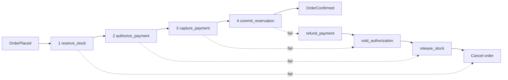
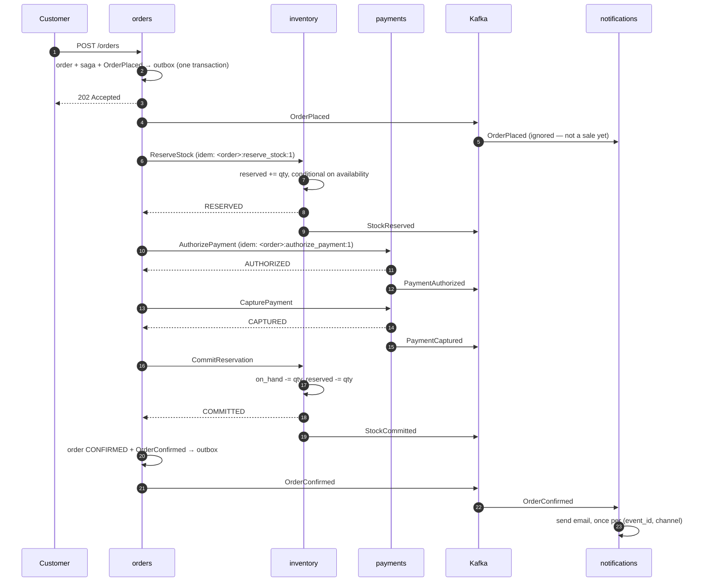
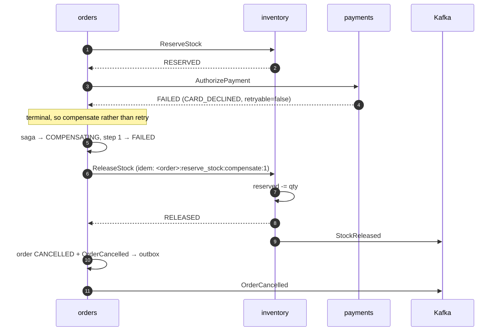
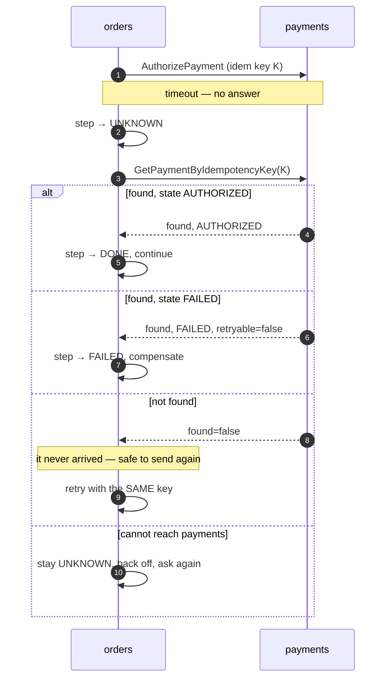
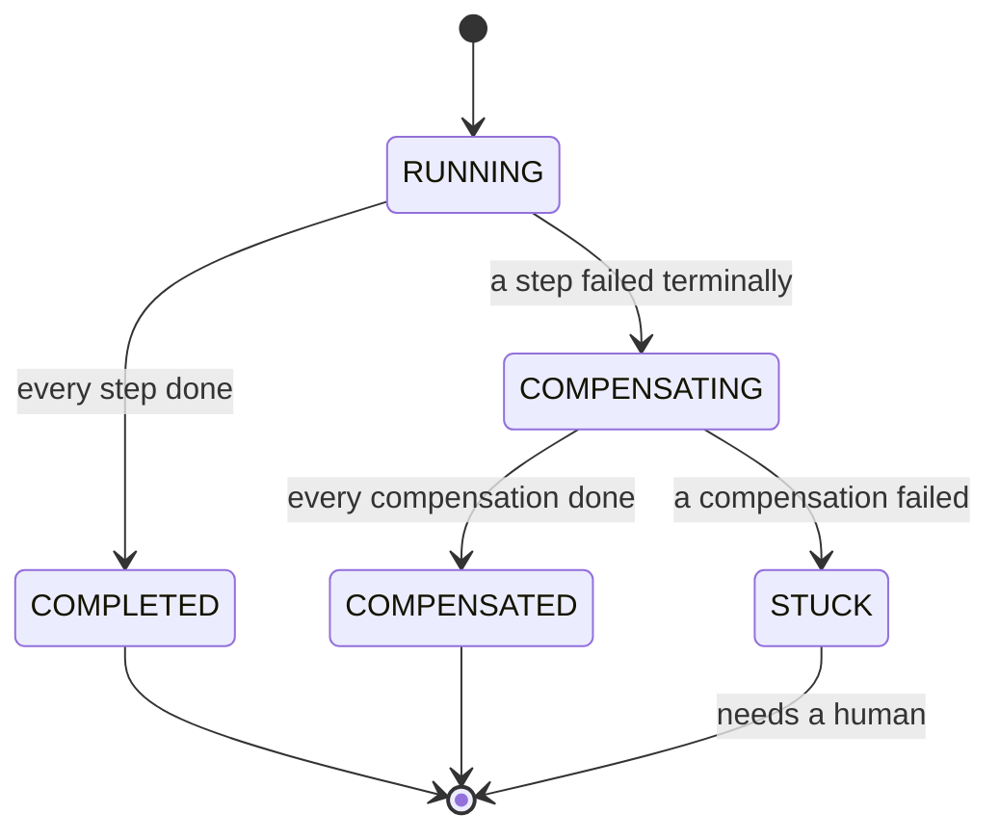

# The fulfilment saga

Three things must happen for an order to be fulfilled: stock must be claimed, money must be
taken, and the stock must be deducted. They live in three services with three databases, so
they cannot happen in one transaction. That is the whole problem, and this document is the
answer to it.

Implementation: [`services/orders/internal/core/saga.go`](../services/orders/internal/core/saga.go).

---

## 1. The steps



| # | Step | Service | Compensation | Reversible without the customer noticing? |
|---|---|---|---|---|
| 1 | `reserve_stock` | inventory | `release_stock` | Yes — stock figures return exactly as they were |
| 2 | `authorize_payment` | payments | `void_authorization` | Yes — a hold that is released leaves no trace |
| 3 | `capture_payment` | payments | `refund_payment` | **No** — a refund appears on a statement |
| 4 | `commit_reservation` | inventory | none | n/a — nothing runs after it |

### Why this order

**Forward: cheapest and most invisible first.** Reserving stock is free and reversible with
no customer-visible effect. An authorization appears on a customer's statement, even if it
is voided seconds later. So the system finds out whether it can supply the goods *before*
it touches anyone's card. An order refused for want of stock never produces a payment
record at all — asserted by `TestInsufficientStockFailsFirstStep`.

**Backward: release stock last.** Compensations run in reverse, so the order is refund →
void → release. That ordering is deliberate beyond simply being the reverse: if compensation
gets stuck partway, the state it is stuck in should be *"we are still holding stock we do
not need"* rather than *"we have released the stock but still hold the customer's money"*.
The first is an inventory discrepancy; the second is a complaint.

**`commit_reservation` has no compensation, and is last.** Undoing a deduction means
physically restocking, which this system does not model. Being last is what makes that safe:
nothing runs after it, so nothing can fail and demand that it be undone.

---

## 2. The happy path



The customer gets `202 Accepted`, not `201 Created`. The order is accepted but not
fulfilled — no stock is checked and no money has moved at that point. The eventual
consistency between placing and confirming is real and customer-visible, so the API says so
rather than using a status code that implies more than happened.

---

## 3. Compensation

The most instructive failure: the card is declined *after* stock has been reserved.



Two details that are easy to get wrong:

**`OrderCancelled` is published only after every compensation has completed.** Its schema
documentation promises that a consumer seeing it can assume the system holds nothing on the
customer's behalf. That promise is kept by ordering, not by hope.

**A compensation that finds its work already done has succeeded.** `ReleaseStock` on an
already-released reservation returns `RELEASED`, and `VoidAuthorization` on an unknown
payment returns `NOT_FOUND` — both are treated as success by the caller. If they were
errors, retrying a compensation would be unsafe, and a compensation that cannot be retried
is a compensation that fails permanently the first time the network hiccups.

### What runs, per failing step

| Fails at | Compensations run, in order | Customer-visible trace |
|---|---|---|
| 1 `reserve_stock` | none — nothing had succeeded | none |
| 2 `authorize_payment` | `release_stock` | none |
| 3 `capture_payment` | `void_authorization`, `release_stock` | none |
| 4 `commit_reservation` | `refund_payment`, `void_authorization`, `release_stock` | **a refund on the statement** |

Only a failure at the last step is visible to the customer as anything other than a
cancellation. That is the cost of `capture_payment` preceding `commit_reservation`, and it
is why the reservation TTL is set generously — see §5.

### The matrix is tested, not just asserted

`services/orders/internal/core/saga_test.go` forces a terminal failure at **each** step
index and checks the exact sequence of calls the engine made:

```
every step succeeds   reserve  authorize  capture  commit
fails at step 0       reserve                                          ← nothing to undo
fails at step 1       reserve  authorize                      release
fails at step 2       reserve  authorize  capture       void  release
fails at step 3       reserve  authorize  capture  commit  refund  void  release
```

Scripted ports rather than the real services, deliberately. Failure at `capture_payment` or
`commit_reservation` is very hard to provoke through the running system — you would have to
make a provider fail *only* on capture, or expire a reservation inside the window between
capture and commit — and any test that tried would be timing-dependent and flaky. What is
under test here is the engine's logic, so the failure is scripted and the assertion is
exact.

The same file also pins the properties that are easy to regress: a **retryable** failure
must not compensate, an **ambiguous** outcome must reach `UNKNOWN` and never `FAILED`, a
failed compensation must leave the saga `STUCK` and the order **not** reported as cancelled,
and re-advancing a completed saga must make no further calls.

---

## 4. A timeout is not an outcome

This is the single most important decision in the repository.

If `AuthorizePayment` times out, orders does not know whether the payment was authorized.
Both assumptions are wrong some of the time:

- **Assume failure** → compensate and cancel. If the authorization *did* happen, a hold is
  left on the customer's card that nothing will ever release.
- **Assume success** → carry on. If it did not happen, the order is confirmed unpaid.

So the saga assumes nothing. A timed-out step is recorded as **`UNKNOWN`**, never `FAILED`,
and resolved by *asking*:



This works only because **every command carries a caller-generated idempotency key that is
stable across retries**. The key is `<order_id>:<step_name>:1` — fixed, not per-attempt. A
key that varied per attempt would make each retry a new request, and a timed-out authorize
followed by a retry would charge the customer twice.

`found=false` is a real answer, not an error. It is the reason `GetPaymentByIdempotencyKey`
and `GetReservation` exist at all.

**If reconciliation itself fails, the saga stays `UNKNOWN` and retries.** It is never forced
to a conclusion. `TestPartitionedPaymentsIsNeverMistakenForADecline` in `tests/chaos/`
asserts exactly this: during a partition, no order is cancelled and no step is marked
`FAILED`.

### Which errors are ambiguous

| gRPC code | Treated as | Why |
|---|---|---|
| `DeadlineExceeded` | ambiguous | The classic case: no answer arrived |
| `Unavailable` | ambiguous | Usually a refused connection, but it can also follow a request that was written and then lost |
| `Unknown`, `Aborted` | ambiguous | The callee's state is genuinely unclear |
| everything else | a plain error | The callee answered, and it answered badly |

Treating `Unavailable` as ambiguous costs one extra reconciliation call in the common case.
Not treating it as ambiguous costs a double charge in the uncommon one.

---

## 5. The time budget

These numbers are related, and the relationships matter more than the values.

| Setting | Default | Constraint |
|---|---|---|
| `SAGA_STEP_TIMEOUT` | 10s | Bounds one network call |
| `SAGA_LEASE` | 30s | **Must exceed** a step plus its resolution attempt (2 × step timeout) |
| `SAGA_RETRY_BASE` | 2s | Doubles per attempt, from the persisted attempt count |
| `SAGA_RETRY_MAX` | 5m | Ceiling on the backoff |
| `RESERVATION_TTL` | 300s | **Must exceed** the worst-case time from step 1 to step 4 |

**Why the lease must exceed the step timeout.** The lease is what stops two orchestrator
replicas advancing one saga at once. If it expired while a step was still in flight, a
second replica would claim the saga and issue the same step concurrently. The keys would
save it from double-charging, but the two would race to write the step log. 30s against a
10s step plus a 10s resolution leaves headroom.

**Why the reservation TTL must exceed the whole forward path.** Four steps at 10s each is
40s in the worst case with no retries; with a few backoffs it is minutes. If the TTL were
shorter, a perfectly healthy saga would reach `commit_reservation` and be told `EXPIRED` —
cancelling an order that should have succeeded. 300s is generous on purpose: **being too
short cancels good orders; being too long only means a dead saga's stock takes longer to
come back.** The failure modes are not symmetric, so the default is not centred.

Inventory publishes `reserved_duration_ms` on `ReservationExpired` so this can be tuned by
measurement rather than guesswork. **A `ReservationExpired` event during a healthy saga
means the TTL is too short**, and that is what the field is for.

---

## 6. State, and why it is in the database



Step states: `PENDING` → `DONE` | `FAILED` | `UNKNOWN` → `COMPENSATED`.

**Every step's state is persisted before the step is attempted.** The saga log is the source
of truth for what has been tried, not the process's memory. A crashed orchestrator therefore
loses nothing: `RecoveryLoop` finds sagas whose `next_attempt_at` has passed and resumes
them, in this process or another one.

**Backoff lives in the database too**, as `next_attempt_at` plus a persisted attempt count,
rather than as a sleeping goroutine. A restart does not reset a backoff that was already
several minutes long, and no work is lost because a process holding it in memory went away.

### `STUCK`

`STUCK` means a **compensation** failed. The saga cannot go forward and cannot go back.

This is the one state the system never resolves automatically, and that is deliberate.
Pretending otherwise would mean silently losing either a customer's money or the shop's
stock. It is logged at error level with everything needed to act, and it waits for a human.

`GET /orders/{id}/saga` exposes the step log for exactly this reason: when an order is not
progressing, the only useful question is *which step, and what did it say*, and answering it
from the service that owns the state beats reconstructing it from four log streams.

---

## 7. What is not modelled

- **Partial fulfilment.** An order is all or nothing. Splitting a shipment would mean a
  saga per line and a different order aggregate.
- **Restocking.** `commit_reservation` has no compensation. A real system would raise a
  warehouse task; this one is honest that it stops there.
- **More than one payment per order.** The schema allows it — payment events are keyed by
  `payment_id`, not `order_id` — but the saga never creates a second one.
- **Automatic recovery from `STUCK`.** By design, see above.
- **Saga timeouts.** A saga retries with backoff up to `RETRY_MAX` and then keeps retrying
  at that interval indefinitely. There is no point at which it gives up and cancels, because
  giving up on an order whose payment state is unknown is exactly the guess this design
  refuses to make.

---

*Previous: [`event_catalogue.md`](event_catalogue.md) · Next: [`tracing.md`](tracing.md)*
