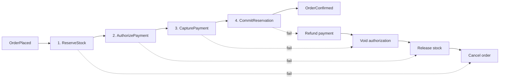

# Service boundaries and domain model

This document is the reasoning behind the decomposition. It is written before any
service code so that the boundaries are argued rather than discovered.

It answers four questions:

1. What is the domain, and what are its invariants?
2. Why these four services and not some other number?
3. Who owns which data, and what happens when a boundary is crossed?
4. Which interactions are synchronous and which are asynchronous, and why?

---

## 1. The domain

The system fulfils retail orders. A customer places an order for one or more SKUs.
The system must reserve stock, take payment, and confirm the order — or undo whatever
it already did and tell the customer no.

That single sentence contains the whole difficulty: **the three things that must happen
cannot happen in one transaction.** Stock lives in one datastore, money in another, and
the order record in a third. There is no distributed transaction available and none is
wanted. Everything else in this repository follows from that constraint.

### Ubiquitous language

| Term | Meaning | Not to be confused with |
|---|---|---|
| **Order** | A customer's intent to buy, plus its lifecycle state | The shipment, which this system does not model |
| **Order line** | One SKU and quantity within an order | A stock item |
| **Reservation** | A time-limited claim on stock, not yet deducted | A deduction, which is permanent |
| **On hand** | Physical units in the warehouse | Available units |
| **Available** | `on_hand − reserved`. What a new order may claim | On hand |
| **Authorization** | A hold on a customer's funds, reversible | A capture |
| **Capture** | Actual movement of money, reversible only by refund | An authorization |
| **Saga** | The orchestrated sequence that fulfils one order | A database transaction |
| **Compensation** | A business action that undoes a completed step | A rollback |

The distinction between *reservation* and *deduction*, and between *authorization* and
*capture*, is what makes compensation possible at all. Both domains natively support a
two-phase shape — claim then commit — and the saga is built on top of that rather than
pretending a rollback exists.

### Aggregates and their invariants

An aggregate is a consistency boundary: everything inside it is updated in one
transaction, and nothing outside it is. The invariants below are the reason each
aggregate exists.

**Order** (owned by `orders`)

- An order's state moves only forward through a fixed graph:
  `PENDING → AWAITING_PAYMENT → CONFIRMED` or `→ CANCELLED`. `CONFIRMED` and
  `CANCELLED` are terminal.
- `total_amount` equals the sum of its lines. Lines are immutable once placed.
- An order has at most one active saga.

**Payment** (owned by `payments`)

- A payment's `authorized_amount` is never exceeded by the sum of its captures.
- The sum of refunds never exceeds the sum of captures.
- Every state change appends an immutable ledger entry. The balance is derived from
  the ledger, never overwritten in place.
- One `(idempotency_key)` maps to exactly one authorization, forever.

**StockItem** (owned by `inventory`)

- `reserved ≤ on_hand`. Available stock is never negative.
- A reservation is created only if `on_hand − reserved ≥ quantity`, and that check and
  the increment of `reserved` happen atomically.
- Every reservation has an expiry. An expired reservation releases its claim.

**NotificationRecord** (owned by `notifications`)

- One `(event_id, channel)` produces at most one delivered notification.

Each invariant is enforced inside exactly one service, by that service's database, under
one local transaction. **No invariant spans two services.** That is the test the
decomposition has to pass, and it is the primary justification for where the lines fall.

---

## 2. Why these four services

### The decomposition criterion

Services are split along **invariant ownership and rate of change**, not along nouns and
not along team convenience. The rule applied:

> If two pieces of state must be mutually consistent at every instant, they belong in one
> service. If they can be eventually consistent, they may be split — and should be split
> when they differ in their reason to change, their failure tolerance, or their load shape.

Applying that rule:

| Service | Language / store | Owns the invariant | Reason to change | Failure tolerance |
|---|---|---|---|---|
| **orders** | Go / PostgreSQL | Order lifecycle graph | Checkout and order-status rules | Customer-facing; must stay up to accept orders |
| **payments** | Go / PostgreSQL | Money never double-charged | PSP integrations, financial regulation | Must be correct before available; refuses rather than guesses |
| **inventory** | Node.js / MongoDB | Available stock never negative | Warehouse and catalogue rules | Read-heavy; a stale read is acceptable, an oversell is not |
| **notifications** | Node.js / MongoDB | One notification per event per channel | Templates, channels, locales | Fully sheddable; nothing waits on it |

Those four columns differ for every row. That is the argument: each service has a
distinct invariant, a distinct reason to change, and a distinct failure posture. A split
that cannot show that is a split that should not exist.

### Why not fewer

**Why isn't payments part of orders?** They share no invariant. An order can be cancelled
without touching a payment, and a refund can be issued against a cancelled order. More
decisively, they have incompatible failure postures: orders should stay available and
degrade (accept the order, resolve it later), whereas payments must never be available at
the cost of correctness. Merging them would force one policy on both, and it would be the
wrong policy for one of them. Payments also carries a compliance and audit burden — an
append-only ledger, restricted access, a separate deployment cadence tied to PSP changes —
that there is no reason to impose on order state.

**Why isn't inventory part of orders?** This is the closest call, because the ordering flow
touches stock on nearly every request. They are split because the availability invariant
is global across all orders, not local to one. Stock is contended by every concurrent
customer, so it is the hottest write in the system and the one most likely to need
independent scaling, caching, or sharding by SKU. Folding it into orders would make the
order database the bottleneck for the whole system and would couple catalogue changes to
checkout deployments.

**Why isn't notifications part of orders?** Because nothing depends on it. It is a pure
downstream consumer with no synchronous callers, so it is the one service that can be down
for an hour with no correctness consequence — only a latency one. Keeping it separate is
what makes that true; folding it in would put a flaky third-party email API inside the
transaction path of order placement.

**Could this be a modular monolith?** Yes, and for a single team at low volume it probably
should be. This repository exists to demonstrate the distributed failure modes — partial
failure, duplicate delivery, ambiguous outcomes, cross-process tracing — which only appear
once the processes are genuinely separate. That is an honest statement of motivation
rather than a claim that four services is the right answer for every business at every
size. See [Limitations](#7-known-costs-of-this-decomposition).

### Why not more

The obvious further splits were considered and rejected:

- **A separate `saga-orchestrator` service.** Rejected. The saga's state is the order's
  state; splitting them would create an invariant spanning two services — exactly what the
  criterion forbids — and would require a distributed transaction to keep the order status
  and saga status in step. The orchestrator lives inside `orders`, writing saga state in
  the same PostgreSQL transaction as the order it drives.
- **A separate `catalogue` service.** Rejected as unused ceremony. Nothing in the fulfilment
  flow reads product metadata; SKU is an opaque identifier here.
- **Splitting `payments` into authorization and settlement.** Rejected. They share the
  ledger invariant (`refunds ≤ captures ≤ authorized`), so they are one consistency
  boundary.

---

## 3. Data ownership

Every table and collection is written by exactly one service. There is no shared database
and no cross-service SQL. Each service's store is reachable only by that service.

```
orders      → PostgreSQL  orders_db     orders, order_lines, saga_instances,
                                        saga_step_log, outbox, processed_events
payments    → PostgreSQL  payments_db   payments, ledger_entries,
                                        outbox, processed_events
inventory   → MongoDB     inventory_db  stock_items, reservations,
                                        outbox, processed_events
notifications → MongoDB   notifications_db  notifications, processed_events
```

`processed_events` and `outbox` appear in every service. They are not domain tables; they
are the two mechanisms that make the messaging correct, and they are described below.

### Why polyglot persistence

Honest version first: **the brief mandates both PostgreSQL and MongoDB**, so the
interesting question is not whether to use both but which services genuinely suit which.

- `orders` and `payments` are in **PostgreSQL** because both need multi-row transactions
  over a rigid schema with real constraints. An order and its lines and its saga state and
  its outbox row commit together or not at all. Payments needs a unique index to enforce
  idempotency and a check constraint to keep the ledger honest. These are exactly what a
  relational database is for.
- `inventory` is in **MongoDB** because the reservation operation is a single-document
  conditional update. `on_hand` and `reserved` for one SKU live in one document, so
  `findOneAndUpdate` with a filter of `on_hand - reserved ≥ qty` is atomic without any
  transaction at all. The operation the system performs most is the one the datastore does
  best in a single round trip.
- `notifications` is in **MongoDB** because notification payloads are heterogeneous per
  channel and template, there are no cross-document invariants, and the workload is
  append-then-read-by-key.

Where this reasoning is weaker than it sounds: PostgreSQL would serve `inventory`
perfectly well — `UPDATE ... WHERE on_hand - reserved >= qty` is equally atomic — and it
would serve `notifications` fine too. The polyglot split is defensible, but it is not
forced by the domain. It is recorded here as a constraint of the brief, honestly labelled,
rather than dressed up as a necessity.

### Crossing a boundary

A service that needs another service's data has exactly three options, in order of
preference:

1. **Don't.** Most cross-service reads are a sign the boundary is wrong. Re-examine first.
2. **Subscribe to its events** and keep a local read model. Eventually consistent, no
   runtime coupling, survives the other service being down.
3. **Ask it synchronously over gRPC.** Introduces a runtime dependency and a failure mode.
   Justified only when the caller cannot proceed without a fresh, authoritative answer.

The saga uses option 3 for its command steps and option 2 for everything else. That choice
is argued next.

---

## 4. Synchronous or asynchronous

The system uses both, and the split is deliberate. The rule:

> **Commands are synchronous. Events are asynchronous.**
>
> A command is directed at one service, expects an outcome, and the caller cannot continue
> without it. An event is a statement of fact broadcast to an unknown set of listeners, and
> the publisher does not care who hears it.

### Synchronous calls (gRPC over protobuf)

| Caller | Callee | Call | Why it must be synchronous |
|---|---|---|---|
| orders (saga) | inventory | `ReserveStock` | The saga's next step depends on whether stock was obtained. There is nothing useful to do until the answer is known. |
| orders (saga) | inventory | `ReleaseStock` | Compensation. Must be confirmed before the saga is recorded as compensated. |
| orders (saga) | inventory | `CommitReservation` | Turns the reservation into a deduction. |
| orders (saga) | payments | `AuthorizePayment` | Same reason: the branch depends on the result. |
| orders (saga) | payments | `CapturePayment` | Same. |
| orders (saga) | payments | `VoidAuthorization` / `RefundPayment` | Compensation. |
| orders (saga) | payments | `GetPaymentByIdempotencyKey` | Reconciliation after an ambiguous outcome — see below. |
| orders (saga) | inventory | `GetReservation` | Reconciliation, same reason. |

The alternative — sending commands over Kafka and correlating replies on a response topic —
was rejected. It re-implements request/reply on top of a log, adds two broker hops of
latency to every step, and makes the saga's control flow invisible in a trace. It buys
back-pressure and durability that the saga does not need, because the saga's own persisted
state is already the durable record of what must happen next. If the callee is down, the
saga should know immediately and retry on its own schedule rather than have commands pile
up in a topic that nobody is reading.

### Asynchronous events (Kafka)

Every state change that other services might care about is published as an event, after the
fact, to a topic owned by the publishing service. Publishers do not know their subscribers.

```
orders.v1.events        OrderPlaced, OrderConfirmed, OrderCancelled
payments.v1.events      PaymentAuthorized, PaymentCaptured,
                        PaymentRefunded, PaymentFailed
inventory.v1.events     StockReserved, StockReleased,
                        StockCommitted, ReservationExpired
notifications.v1.events NotificationSent, NotificationFailed
```

Events are keyed by aggregate id (`order_id`, `payment_id`, `sku`) so that all events for
one aggregate land on one partition and are delivered in order. Cross-aggregate ordering is
not guaranteed and no consumer may assume it.

`notifications` is a pure subscriber: it consumes from all three upstream topics and calls
nobody. That is what makes it sheddable.

### The uncomfortable part: synchronous calls inside a saga

Choosing gRPC for saga steps has a real cost that has to be handled rather than waved away.

**Problem 1 — the orchestrator blocks.** A saga step waits on a network call. Handled by
bounding every call with a deadline (see `docs/sagas.md` for the values) and running each
saga instance as an independent unit of work, so a slow step blocks one order, not the
service.

**Problem 2 — the orchestrator can crash mid-saga.** Handled by persisting saga state
*before* each step is attempted, in the same transaction as the order update. On restart, a
recovery loop finds sagas with an in-flight step and resumes them. The saga log is the
source of truth for what has been attempted, not the process's memory.

**Problem 3 — the ambiguous outcome.** This is the hard one. If `AuthorizePayment` times
out, the orchestrator does not know whether the payment was authorized. Both assumptions are
wrong some of the time: assume failure and you may leak an authorization on the customer's
card; assume success and you may confirm an unpaid order.

The resolution is that **a timeout is not an outcome.** A timed-out step moves to state
`UNKNOWN`, and the saga resolves it by *asking*, not guessing: it calls
`GetPaymentByIdempotencyKey` with the same key it sent, and the callee — which owns the
truth — reports whether that key produced an authorization. This works only because every
command carries a caller-generated idempotency key that is stable across retries, which is
what `libs/idempotency` exists to provide. If reconciliation also fails, the saga stays
`UNKNOWN` and is retried with backoff rather than being forced to a conclusion.

This is the single most important design decision in the repository and the one the failure
injection tests in `tests/chaos/` are built to prove.

### Reliable publishing: the transactional outbox

A service that commits a state change and then publishes an event has a window in which it
can crash between the two, losing the event. Publishing first and committing second is worse.

Every service therefore writes its events into an `outbox` table **in the same local
transaction as the state change**. A relay process reads the outbox and publishes to Kafka,
marking rows as sent. If the relay crashes after publishing but before marking, the event is
published twice — which is acceptable, because every consumer is idempotent by construction.

This gives at-least-once publishing with no lost events, and turns the exactly-once problem
into a deduplication problem, which is solvable locally. The system does not claim
exactly-once delivery; it claims **at-least-once delivery with exactly-once processing**,
which is the honest and achievable version.

---

## 5. The fulfilment saga

The full sequence diagrams and step table live in `docs/sagas.md`. The summary:



Forward steps run in order; on failure at step *n*, the compensations for steps *n−1 … 1*
run in reverse. Compensations are ordered deliberately: stock is released last on the way
back because it is the cheapest thing to hold and the most expensive thing to lose.

Step order on the forward path is also deliberate. Stock is reserved before payment is
authorized because reserving is cheap and reversible with no customer-visible effect,
whereas an authorization appears on a customer's statement. Fail on the cheap, invisible
step first.

---

## 6. What each service must not do

Constraints that fall out of the above, stated so they can be checked in review:

- No service reads another service's database. Ever.
- No service calls another synchronously except through the gRPC contracts in `proto/`.
- `orders` is the only service that runs a saga orchestrator.
- `payments` never initiates. It only responds to commands and reports facts.
- `inventory` never decides business outcomes; it answers "can I have this stock" honestly
  and enforces its own invariant.
- `notifications` calls nobody and blocks nothing.
- Every consumer is idempotent. A consumer that cannot tolerate redelivery is a bug.
- Every published event is written through the outbox, never published directly.

---

## 7. Known costs of this decomposition

Stated plainly, because a rationale that lists only benefits is marketing.

- **Latency.** Placing an order now costs four sequential network round trips instead of
  one local transaction. In-process this would be sub-millisecond.
- **Eventual consistency is customer-visible.** Between `OrderPlaced` and `OrderConfirmed`
  the order is in a state the customer can observe and that the system cannot yet honour.
  The API exposes this state explicitly rather than hiding it.
- **Compensation is not rollback.** A refunded payment is not an un-happened payment. It
  leaves a trace on the customer's statement and in the ledger. The domain accepts this;
  a database transaction would not have to.
- **Operational surface.** Four services, two database engines, a broker, a schema
  registry, a collector and a tracing backend — to sell one order. For a small team this
  overhead is not repaid.
- **The polyglot store split is brief-driven**, not domain-forced, as noted in §3.
- **Reservation expiry is a timer, and timers lie.** A reservation that expires while a
  saga is mid-flight is possible. It is handled by making `CommitReservation` fail rather
  than silently oversell, which turns a correctness bug into a cancelled order.

---

## 8. What this buys

The decomposition is worth its cost only if it delivers the properties it was chosen for:

- No single database is a bottleneck for the whole system.
- `notifications` failing cannot stop an order being placed.
- `payments` can enforce a stricter consistency and access policy than anything else.
- Each service's invariant is enforced by its own store, so correctness does not depend on
  every caller behaving.
- The failure modes are explicit and testable, which is what `tests/chaos/` exercises.

---

*Next: [`docs/event_catalogue.md`](event_catalogue.md) — the events, their schemas and their
compatibility rules.*
